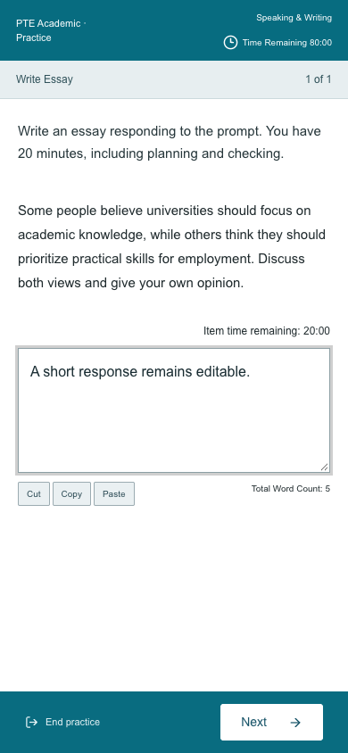
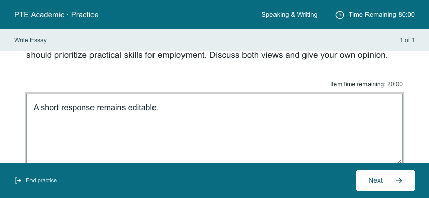

# Fixed app viewport

The outer document stays fixed on desktop, phones and short landscape windows. Preparation, timed questions and necessary content panels retain contained scrolling; the timed header and actions remain visible. App-controlled zoom gestures, modifier-wheel and zoom shortcuts are suppressed. Browser menus and operating-system accessibility overrides remain outside app control.

Focused verification uses the built static app in installed Chrome with desktop (1440×900), phone (390×844), landscape (844×390) and short-phone (360×400) viewports. It exercises actual document scroll attempts, normal response editing, preparation and exit, metadata and touch policies, plus synthetic cancelable keyboard/wheel/Safari gesture events. Native iOS pinch and operating-system zoom were not tested.

The responsive navigation/card journeys, complete original-question review matrix, all active response kinds, and writing timer journey cover affected existing consumers. Full-suite testing is deferred until merge is requested. Reverting this change restores the previous viewport policy; no learner-data migration is involved.

Validation: `npm run build` passed, including content/model validation, TypeScript, chunk-budget and static-output contracts. `PTE_TEST_PORT=4216 npx playwright test tests/practice.spec.ts --grep 'fixed viewport|shared cards list pages learning|screen-sized game navigation|writing tools count|all original questions and full mock review|every active response kind'` passed all 7 journeys. Formatting and `git diff --check` passed.

The new landscape regression initially reproduced document movement after response focus; fixing the body in place resolved it without weakening assertions. An earlier browser run overlapped mutable build/output state and was discarded; the final build and browser selection were run sequentially with a fresh isolated preview.

Merge-stage integration with the updated daily home revealed its separate 451–560px document-expansion fallback. This now uses contained main-panel scrolling too. The existing fresh/partial/completed home journey retains all action/link reachability assertions at 400, 451, 500, 540, 560 and 561px; the document-lock regression adds 451px and 560px sizes. Full merge-stage results are recorded in PR #44.

Full merge-stage validation after the home integration fix: 23 TypeScript contracts, 15 Node artifact/authoring contracts, 14 Python contracts, 39 practice/review browser journeys, 5 comparison-model browser journeys and 2 subpath/offline journeys passed. Both static builds passed their validation/TypeScript/output gates. Progress contracts also passed with the Australia/Sydney timezone. The original independent review is pinned to d2254c1; the subsequent main integration and bounded CSS fallback fix were validated with the full suite, without a second automatic review.
