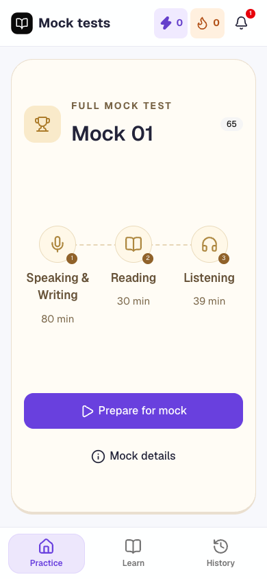
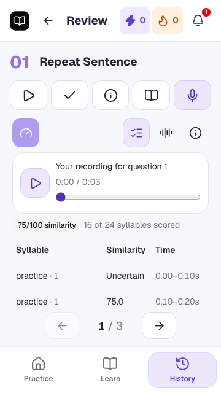

# PTE Studio interface consistency audit

Tracks [#27](https://github.com/WilsonLe/pte-academic/issues/27) and the operator's expanded all-interface request [#32](https://github.com/WilsonLe/pte-academic/issues/32), delivered through [PR #29](https://github.com/WilsonLe/pte-academic/pull/29).

The reference is the existing practice game interface: violet actions and selected controls, lime daily-practice actions, soft track colours, rounded surfaces, large controls, compact navigation and information disclosed on demand. The neutral timed exam remains a deliberate exception. The final candidate incorporates main `33c1158`, preserving its removal of Whisper and word-match actions; previously saved transcripts remain readable. Generated shadcn theme tokens and the vendored stylesheet are unchanged.

## Findings applied

- Shared Buttons expose variant/size metadata. Practice styles use that metadata, since Base UI tooltip/popover render composition can replace `data-slot`. Primary actions, selected guidance/filter/review controls, secondary actions and keyboard focus now share the practice vocabulary, including portal content.
- Preflight uses the shared violet quest card, lime Begin action, readable plan/count, media-check cards and collapsed details. Start requirements and lifecycle are unchanged.
- Mock preparation has a large labelled action. The stage connector follows the actual node centres on desktop, mobile and short windows.
- Achievement screens show the heading once, with a separate earned count. Supporting progress, achievement, mode, history and mock text has stronger contrast on its soft surfaces. Decorative stars are hidden from assistive technology.
- Empty/search/missing/loading recovery panels share alignment and surface treatment. Existing actionable error text is retained.
- Practice dialogs and notifications share rounded surfaces and readable controls. Close targets are at least 44 pixels; confirmation actions wrap on narrow/zoomed screens. Clear history uses the destructive variant. Exam confirmation dialogs retain neutral styling and gain the same wrapping/scroll protection.
- Notification progress uses the practice accent; loading, ready, failure and retry remain in the header popover. No preparation banner was added.
- Speech panel selectors expose their selected state and names for icon controls. Short-phone syllable results reserve room for a readable header and row, with a local scroll escape when media/toolbar controls consume the panel. A regression test covers this case, including uncertainty and paging.

## Complete surface inventory

Each row is included in the audit. “Retained” means its existing distinct treatment is intentional; it does not mean the owner was skipped. Shared fixes apply wherever the practice context is present.

| Surface / owner | States and consumers checked | Disposition and evidence |
| --- | --- | --- |
| Document, routes, hydration (`RootDocument`, `routes`, `routing`, `PracticeSession`) | Shell, typed destinations, deep links, missing/loading, reload/back/forward | Retained. Source review; route/reload and navigation journeys. No framework changes in this PR. |
| Desktop rail, mobile header/footer (`App`) | Practice/Learn/History, practice submodes, active navigation, truncated long title, back | Retained structure; shared control/focus treatment. Responsive navigation journey and route matrix. |
| Header XP/streak/update and notifications | Progress links; model loading/error/retry/ready; available update action | Shared button metadata; notification styles and progress accent. Header notification test exercises disclosure, focus return, retry and ready persistence. Update mechanism retained; no activation changes. |
| Global recovery (`App`) | Empty/missing session, missing route, progress/storage/offline errors | Aligned empty/recovery panels; critical error copy retained. Missing-route matrix and source review. Storage failures remain failures, not fabricated success. |
| Daily play (`GameHub`) | New, partial, complete daily goal, mode cards, XP guidance | Existing violet/lime composition retained; shared focus and supporting text contrast. Daily persistence/reset journey covers reward states. |
| Progress (`GameHub`) | Level, remaining XP, streak, weekly active/current/rest days | Existing measured layout retained; supporting labels darkened. Progress screenshots, navigation journey. |
| Achievements (`GameHub`) | Locked/earned, pagination, detail dialog | Removed duplicate heading; readable labels; practice dialog/close sizing. Screenshots, collection navigation and earned badge journey. |
| Question catalogue (`LearningScreens`, `CardsList`, `App`) | All 22 types, section filters, search/no matches/reset, resize, paging | Shared filter/focus/search surface styling. Catalogue pagination/resizing and filter-state journeys; every guide in the route matrix. |
| Question guidance (`GuideScreen`, `ReadingPages`) | Ready, Instructions, Strategy & tips, How to review, Start | Violet selected/primary controls; neutral reading surface retained. All 22 guide variants measured at phone and desktop sizes. |
| Sections (`SectionSelect`) | Speaking & Writing, Reading, Listening; progress, details, pager, Start | Track backgrounds retained; shared selected/primary controls and readable progress text. All three detail views in the matrix; section selection journey. |
| Full mock (`App`) | Stage summary, details dialog, preparation | Labelled large action; corrected connector geometry; readable labels and stage numbers. Screenshots, details matrix and full-mock progression journey. |
| Learning catalogue/article (`LearnScreen`) | Every topic, overview/block selector, back, practise, measured pages | Neutral learning typography/surfaces retained; practice actions/focus aligned. Every article block in the route matrix; learning pagination journey. |
| History (`HistoryScreen`, `CardsList`) | Empty, populated/long labels, compact cards, multiple pages, clear/keep | Centred empty panel; readable secondary text; destructive clear action; wrapping dialog actions. History responsive/paging and daily reset journeys; seeded screenshots. |
| Review (`App`, `Pages`) | Response, answer key, feedback, prompt, question pager | Shared selected controls; measured neutral reading preserved. Seeded mobile/desktop captures and saved-review journeys. |
| Review media/chart/rewards | Recording playback, chart, reward/level/badge moment | Existing shared audio, responsive chart and finite celebration retained. Seeded captures, microphone/playback and daily XP journeys. |
| Preflight (`Runner.Preflight`) | Daily/type/section/mock; no media/audio/mic/both, sample, denial, details, begin/back | Shared game surface and accessible checks; existing start guards preserved. Rendered matrix and microphone/mock/route journeys. |
| Timed Runner (`Runner`, `QuestionInput`) | Countdown/audio/blocked/prepare/answer/complete/error; speak/write/dictation/single/multi/order/dropdown/bank/blanks/highlight | Neutral exam styling intentionally retained. All input branches read; representative kind screenshots and focused input/timing journeys. No hints, transcripts or answer keys added to a running test. |
| Runner next/end dialogs | Blank response confirmation, keep practising, continue/end | Neutral treatment retained; action wrapping and maximum-height scroll protection. Input/end journeys; narrow-dialog inspection. |
| Speech review (`SpeechReview`) | Idle, help, legacy saved transcript, syllables, progress/cancel/error | Shared selected controls and accessible names; short-panel table escape. Seeded states, legacy-transcript compatibility test and new short-phone syllable-row regression. Processing/save/cancel logic unchanged. |
| Syllable table (`SyllableScores`) | Scored/uncertain values, times, first/next page | Tabular numbers, readable minimum panel; uncertainty remains text. Persisted synthetic fixture, row/pager regression; no score semantics changed. |
| Shared primitives | Button default/outline/secondary/ghost/destructive/disabled/focus, cards, badges, tooltips, dialogs/popovers, pagers, reading, playback | Inspected all owners and consumers. Scope accents by `.practice-ui`; retain generated defaults outside it. Playback/keyboard/recovery and layout journeys cover interactions. |
| Development tools (`Devtools`) | Development-only Query/Router tools | Explicitly excluded from learner styling: no development controls ship in the production client. Source review of build-time guard. |

## Validation and limits

- `npm run build`: content/media contracts, pinned model pack, Start static shell generation, TypeScript, client publish and service-worker build. The existing large-chunk warning remains.
- Focused Chromium selection covers responsive cards/navigation/reading, all response-control families, recording/review, one-play listening, mock progression, media denial, daily rewards, reload/back, shared playback, filters/history and notifications. Full repository/model inference suites are deferred until merging is requested; this task does not authorize merge or deployment.
- Current validation: 21 focused practice browser journeys and 2 focused speech-review journeys passed, including the new regression; the static-output contract passed. The route/content matrix passed 504 states at 320×568, 360×640, 390×844 and 1440×900, and separate captures passed all 10 response-control kinds. Sixteen confirmation/info/achievement dialog checks passed across those sizes.
- Additional browser matrix checks all 22 guidance screens/tabs, every learning topic/block, section details, basic routes, mock disclosure and representative runner kinds at narrow phone and desktop sizes. Saved review fixtures exercise legacy transcript/syllable/chart rendering without invoking models.
- Screenshots and disposable browser fixtures live under ignored `artifacts/ui-audit/`; they contain synthetic practice state. Any controlled download failure proves its error presentation, not an actual provider failure. Real download/recovery is separately covered by the focused notification journey.
- Native iOS/Safari, OS text scaling, and a screen reader were not available. Chromium mobile viewports and keyboard checks do not establish those device-specific outcomes. Generated colours/gradients and decorative icons are not claimed to have a complete automated accessibility certification.

No learning content, credentials, model, persistence schema, grading, XP logic, paid calls or deployment configuration changes are part of this audit. Rollback is a revert of the interface/audit commits.

## Representative captures

